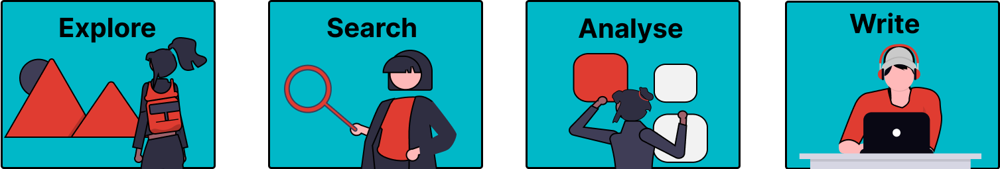

# Introduction

Welcome to this Jupyter Book on generative AI for literature reviews. The goal of this book is to provide you with foundational knowledge about GenAI tools and how you can use them to support you when conducting a literature review. This book is used in courses offered at TU Delft (for BSc and MSc students as well as PhD candidates), but it can also be used for self-study.

If you have consulted this book, please provide us with your feedback to help us refine the resource by filling out <a href="https://forms.office.com/e/hMvRp5wsa2" target="_blank">our evaluation form</a>.

## Structure of the Book

This book serves as a reference guide for all the steps in the literature review. In part 1 of the guide, you can learn more about the fundamentals of GenAI and prompt engineering. Part 2 of the guide will take you through all the steps you need to take when performing a literature review. The book can be read in its entirety, but you can also select the sections that are relevant to you.

If you don't have that much knowledge about AI yet, we recommend that you first read the basics about AI in the [What is GenAI section](part1/what-is-genai). If you have a general understanding, start with the [Introduction to AI Tools for Literature Review](part2/selecting-ai-tool) before heading to the specific sections. It will help you understand how the different types of tools work and how they can be applied effectively.

For each phase of the literature review, we have included a short recap on the standard way of conducting a literature review, to connect to your pre-existing knowledge. Following this you will find examples on how AI can support the literature review, and what types of tools are helpful. We believe that AI is a tool that can augment the research process, but basic ('traditional') skills during the literature review process take a central place and cannot be skipped.



You can easily navigate through the resource via the menu at the left. When you are in a specific section, you can navigate via the headings in the top right corner.

Note that there are different types of literature review (exploratory, systematic, scoping). The steps of the process are presented in a general manner and can be slightly different for each specific type. As the general steps of the literature review process are more or less similar for each review type, this guide will not detail specific literature review types.

## About the Tools Mentioned in this Book
Throughout the guide we present a range of AI tools that are used within the researcher community. Note that we are not affiliated with any of these tools; we simply list tools that have had recent successful use cases within the research community. In addition, we have chosen tools that offer trial or free versions for you to try out yourself.

Not all tools mentioned in this book are supported by TU Delft. As of the date of writing this book TU Delft has a license for <a href="https://copilot.microsoft.com/chats/" target="_blank">Microsoft Copilot Chat</a>. If you want to use other tools, you can often use a free version. On the other hand please be careful of your use and potential risks. See for example [Effective and Responsible GenAI Use](summary-part1.md). For the most up to date guidelines on how to use AI within the context of TU Delft, you can look at the <a href="https://intranet.tudelft.nl/en/group/guest/ai" target="_blank">intranet page on AI at TU Delft</a>.

```{warning}
Always consult the rules and regulations of your faculty, program or course before using AI.
```

Throughout this book we will use formulations such as: "AI tools can help you" or "GenAI tools do not know what they are doing". We are aware that AI tools do not have agency or cognitive abilities, however, for the readability of this guide we will still use this kind of language to describe AI tools.

## Colophon

### About the authors
This guide was created collaboratively by the Centre for Languages and Academic Skills and the Library Education Support Team at Delft University of Technology. The authors are Lisanne Walma (Library Education Support) and Matthijs Looij (Centre for Languages and Academic Skills).

Support for the publishing and development of this book was provided by Caroline den Braber (Library Education Support) and Jacqueline Michielen-van de Riet (Library Education Support).

### Acknowledgements
The authors thank all the reviewers and betatesters of the initial version of this book.

### Sources
The sources that were used for this book are referenced at the end of each section.

### Images
Unless otherwise specified the images used on these pages are adapted from <a href="https://undraw.co/" target="_blank">unDraw</a>, licensed <a href="https://undraw.co/license" target="_blank">open-source</a> by Katerina Limpitsouni.

### Disclosure of AI Use
While creating this book, we used AI for:
- Editing draft texts
- Setting up Jupyter Book based on structure provided
- Suggesting and structuring guided activities

Tools used: 
- OpenAI. (2025). _ChatGPT_ (paid version July 14, 2025 - 4 September 2025) [Large language model]. <a href="https://chat.openai.com/chat" target="_blank">https://chat.openai.com/chat</a>
- Microsoft. (2025). _Copilot_ (August 2025 version) [Large language model]. <a href="https://copilot.microsoft.com" target="_blank">https://copilot.microsoft.com</a>

### Last Updated
Please be aware that the tools and approaches discussed in this guide are subject to change due to the quickly evolving nature of AI. This edition of the book was launched on September 4, 2025.
